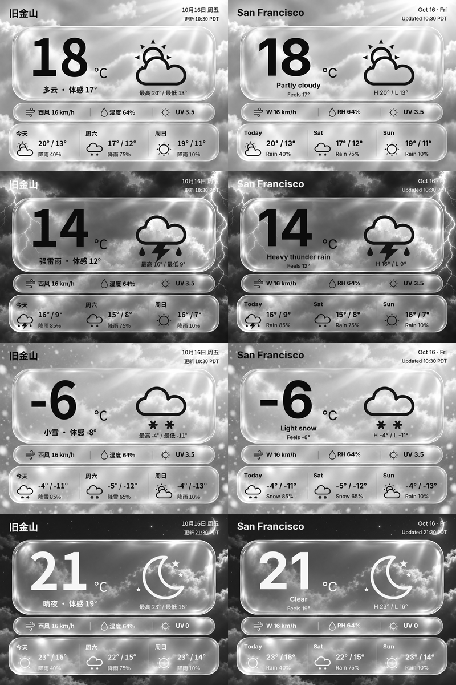

# 液态玻璃天气墨卡 / Liquid Glass Weather

400 × 300 中英文液态玻璃天气墨卡。独立运行，用户自行接入 WeatherAPI；不包含设备 SDK、固件或设备推送适配。



- 60 个 WeatherAPI 天气代码，昼夜、中英文完整映射；另含未知代码兜底。
- 11 张直接从原图编辑的天气玻璃底版，共 240 张天气预览 + 4 张未知天气预览。
- 所有文字、数字和图标均在本地动态绘制；玻璃与天气使用原图编辑底版，不再用程序重绘玻璃边缘。
- 摄氏度、km/h；右上角显示城市当地日期及观测更新时间。
- 当前温度、体感、天气、最高/最低温、风向风速、湿度、UV、今天及未来两天预报。
- 光滑矢量图标，32 / 48 / 96 px 透明 PNG 和 SVG；主图标和小图标共用同一几何。
- 连续 8-bit 灰阶 PNG，不预先抖动或量化，由设备固件处理 gray16。

## 本地运行

需要 Python 3.10+。在本目录运行：

```sh
python3 -m venv .venv
source .venv/bin/activate
python -m pip install -r requirements.txt
python tools/build_assets.py
python src/server.py
```

浏览器打开 `http://127.0.0.1:8765/`，先看中英文整套效果。展开“接入自己的天气”，填写自己的 WeatherAPI Key、城市或经纬度、两种语言的地点显示名称。Key 留空时保留已有设置；首次运行未配置 Key 时显示明确标识的示例数据。更换查询城市时，记得同步修改两种语言的地点名称，或清空地点名称使用接口返回的名称。

Key 和缓存保存在 `~/.zectrix/weather-glass/`；可用 `WEATHER_GLASS_DATA` 指定其他保存目录。Key 不返回浏览器、不写入仓库、不记录请求 URL。也可通过 `WEATHERAPI_KEY` 环境变量设置；环境变量优先于网页保存值。`.env.example` 是说明模板，不会自动加载。

城市建议使用 `latitude,longitude` 避免同名城市。WeatherAPI 账户由使用者自行申请，套餐额度与预报天数以账户为准。

## 直接用 JSON 渲染

```sh
python src/render.py --input examples/forecast.json --output screen-zh.png --lang zh --city 旧金山 --now 2026-10-16T10:30:00-07:00
python src/render.py --input examples/forecast.json --output screen-en.png --lang en --city "San Francisco" --now 2026-10-16T10:30:00-07:00
```

接真实数据时省略 `--now`，日期按城市 `location.tz_id` 实时计算。示例日期固定为 2026-10-16，仅用于设计审核；模拟天气不是当前实况。

自己的服务也可以直接调用：

```python
# Put src/ on your Python module path.
from model import normalize
from render import png
image_bytes = png(normalize(weatherapi_forecast_json, lang="en", city="San Francisco"))
```

## WeatherAPI 接入

请求 `https://api.weatherapi.com/v1/forecast.json`，参数 `key`、`q`、`days=3`、`aqi=no`、`alerts=no`。一个响应包含当前天气和未来预报。语言由本地代码映射；换语言、重绘图片不额外请求 API。默认每个城市缓存 15 分钟，最短 5 分钟，失败后至少 5 分钟再试。默认单城市约 96 次/天；用户数、城市数与多进程部署会影响总调用量。

- 字段与错误说明：[docs/API.md](docs/API.md)
- English integration guide：[docs/INTEGRATION.en.md](docs/INTEGRATION.en.md)
- 设计、素材来源与限制：[docs/DESIGN.md](docs/DESIGN.md)
- 所有图标映射：[assets/icons/mapping.json](assets/icons/mapping.json)
- 官方文档：[WeatherAPI documentation](https://www.weatherapi.com/docs/)

缺少未来某一天时显示未知图标和 `—`；不伪造预报。未知天气代码显示问号图标。观测超过一小时标注旧数据；网络失败但有缓存时标注离线，保留原始观测时间。无缓存且连接失败时显示错误，不把示例数据冒充实况。

## 开发验证

```sh
python -m unittest discover -s tests -v
python tools/build_assets.py
```

`tools/build_assets.py` 可离线重建整套效果图；不会请求天气接口。图片文件名为 `{code}-{day|night}-{zh|en}.png`。生成高分辨率预览可调用 `render(model, scale=3)`。

## 输出与使用范围

程序只生成 PNG，不连接或控制设备。使用者通过自己的显示程序导入图片。仓库保留完整底版、字体、SVG 图标及生成代码；运行 `tools/build_assets.py` 会离线生成 244 张预览和各尺寸 PNG 图标。夜间采用无描边浅色文字和图标。

已通过 11 项自动测试；真实 WeatherAPI 请求需用户自行提供有效 Key。示例中的日期、城市和天气为固定演示数据。

## English

Bilingual liquid-glass weather cards for 400×300 e-paper. Install Python dependencies, run `python tools/build_assets.py`, then `python src/server.py`. Open http://127.0.0.1:8765/ and enter your own WeatherAPI key. The project exports continuous grayscale PNGs and includes no device SDK, firmware, or device transport. See [English integration guide](docs/INTEGRATION.en.md).
